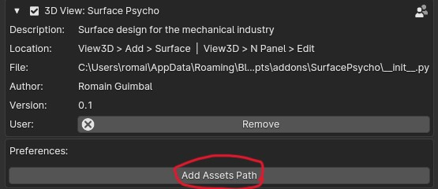
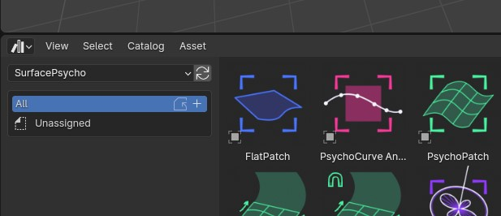
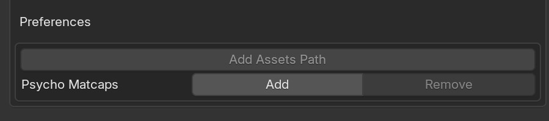

# Install and Setup

## Install
In ``Edit > Preferences > Get Extentions`` Search for "Surface Psycho" and click ``Install``.

## Setup

### Asset library

To register the library, in `Preferences > Add-ons > SurfacePsycho` and click `Add assets path`

You should find a new Asset library in your asset browser

> This simply adds a path to `Preferences > File Paths > Asset Libraries`

## Matcaps
To register SP matcaps go to `Preferences > Add-ons > SurfacePsycho > Psycho Matcaps` and click `Add`

## Troubleshoot
If you encounter any issue not described below, please [report it ↗️](https://github.com/RomainGuimbal/SurfacePsycho/issues).
### "DLL not found"
In some still unclear configurations, the add-on fails to load with an error "DLL not found". To fix it go to your extension folder
`...\Blender Foundation\Blender\X.X\extensions` and delete `.cache` and `.local` folders. This will force to reinstall the external python modules.
> If you encounter any issue with this procedure, please let me know.